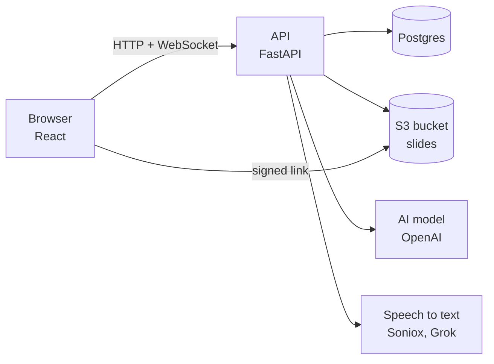
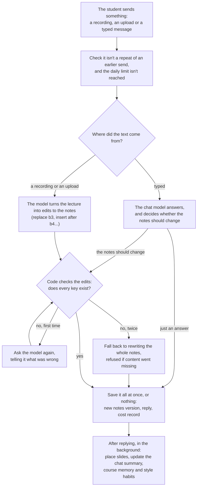

# Veda: design

How Veda is built, and why. Setup is in the [README](README.md); plans are in the [roadmap](ROADMAP.md).

`server/app` is the API (Python, FastAPI). `client/src` is the browser app (React).

---

## What Veda does

A student records a lecture, uploads a recording, or pastes text. Veda turns it into study notes. A chat beside the
notes lets the student shape them ("add an example here", "make this shorter") or ask about them ("what did she mean
by the second condition?").

Each conversation is a **chat** plus **one notes document** that the chat edits, many times, over a whole course.

What makes it hard:

- **Long input.** An hour of lecture is about 14,000 tokens. Sending everything every time is slow and costly.
- **Models make mistakes.** Asked to retype a document, a model can drop a section or invent a fact. Notes must stay
  trustworthy.
- **Work in flight.** A turn waits seconds on the model, and the person may keep working meanwhile.
- **Not every message is an edit.** "Thanks" must leave the notes alone; "yes, add it" must change them.

---

## Architecture



- **Postgres** holds users, chats, notes and their versions, slides, and a record of every model call.
- **The bucket** holds slide PDFs and images. The browser reads them through short-lived signed links.

---

## The notes: keyed blocks

This is the central decision.

The notes are a list of blocks (a heading, a paragraph, a list item...), each with a key:

```json
[
  {"key": "b1", "md": "# Electrostatics"},
  {"key": "b2", "md": "- Like charges repel."}
]
```

The model never retypes the notes. It answers with **edits that name keys**: replace `b2`, insert after `b1`, delete
`b5`. Code applies them, and every other block stays exactly as it was.

- **Keys are never reused,** so anything pointing at a block (a slide, a link in a reply) stays valid.
- **Edits are checked** before they're applied: every key must exist, no block is named twice. A bad answer gets one
  retry with the exact error.
- **A full rewrite is the last resort,** and it's refused if a heading disappears or the text shrinks below 80%.
- **Every change is a version.** The last 50 are kept, and going back is instant.

### In the database

The whole list lives in one `jsonb` column of the conversation's row. Here the notes were started with `b1, b2, b3`,
then `b2` was deleted, then `b4` was inserted after `b1`:

`conversations`

| id | title | note_blocks | note_next_key | note_revision |
| --- | --- | --- | --- | --- |
| c7 | Electrostatics | `[{"key":"b1","md":"# Electrostatics"}, {"key":"b4","md":"## Coulomb's law"}, {"key":"b3","md":"- Like charges repel."}]` | 5 | 3 |

- **The array's order is the document's order,** so `b4` sits before `b3`. Keys are names, not positions.
- **`note_next_key` only goes up.** `b2` is gone, but the next new block is `b5`, never `b2` again.
- **`note_revision` points at the version shown.** Going back to version 2 just sets it to 2.

`note_revisions`: a full copy of the blocks after each change (written here as keys only)

| conversation_id | seq | kind | blocks |
| --- | --- | --- | --- |
| c7 | 1 | start | `b1, b2, b3` |
| c7 | 2 | edit | `b1, b3` |
| c7 | 3 | edit | `b1, b4, b3` |

`slides`: a slide stores the key of the block it follows, so it stays put through any edit that keeps that block

| id | conversation_id | page_number | anchor_block |
| --- | --- | --- | --- |
| s1 | c7 | 4 | `b4` |

**Why not ask for the whole new document each time?** Models quietly change parts they shouldn't, output tokens are
the expensive ones, and nothing could point into plain text. Diffs and search-and-replace were also considered:
models are bad at exact line numbers and exact quotes, but good at copying a short key.

---

## One turn



- **Two flows, chosen by where the text came from,** never guessed from the words. A recording is folded into the
  notes. A typed message goes to the chat.
- **The chat decides for itself whether to edit.** It has tools it may or may not use: `edit_notes`, `read_lecture`,
  `read_course` (other lectures in the course) and `set_title`. This replaced a separate router model and is checked
  by an eval.
- **Short lock, not a long one.** A turn remembers the version it read and only locks the notes while saving. If
  something else changed them meanwhile, the change is re-checked instead of overwriting.
- **All or nothing.** A failed turn is fully undone and the text goes back in the message box.
- **Retries are safe.** Each send carries a request key, so pressing "Send again" never runs or bills the work twice.

---

## Working with the model

- **One model for everything** (`gpt-5.6-luna` by default), behind LangChain so the provider can be swapped. A cheaper
  model was tried for the background jobs and learned worse.
- **Structured output.** Every call returns a typed object (Pydantic). Code checks content, never parses text.
- **A fallback model** takes over on outages (5xx, timeouts), not on bad requests.
- **Prompts are briefings,** not lists of patches: the job, the judgement calls, one example. Anything exact (formats,
  the logistics box) is done in code instead.
- **Laid out for caching.** What never changes comes first, so most input tokens are billed at the cached rate.
- **Fenced against prompt injection.** Lecture text, uploads and slides are wrapped in tags and treated as material,
  never as instructions. The chat's tools can only edit notes, so the worst case is a bad edit that undo reverses.
- **Every call is recorded** with its tokens, model and an automatic prompt version.

---

## Context and memory

The aim: a prompt small enough to be cheap, that still holds what the answer needs.

| The model gets | How |
| --- | --- |
| Recent chat | The last 8 messages, older ones clipped |
| Older chat | A summary, updated in the background |
| The notes | The whole document, with keys |
| The lecture | Only the relevant parts, when needed |
| Other lectures | The relevant sections of their notes, when the chat asks |
| The person | Their profile, their own instructions, learned style habits |
| The course | Its instructions, its glossary, one line per lecture |

**Finding the relevant parts** uses word overlap weighted by rarity (TF-IDF), not embeddings: lecture questions
usually reuse the lecture's own words, and this costs nothing. Cutting block actions from 120,000 to 25,000 tokens of
context scored the same on evals.

**Learning in the background,** after a reply:

- **Course memory:** new terms for the glossary and a one-line summary of each lecture.
- **Style habits:** rules like "prefers short bullets", learned only from what the person does (requests, buttons,
  undos), and only once a pattern repeats.
- **Chat summary.**

The person can see, edit and remove all of it. What they change is never overwritten by the AI. Jobs save with a
version check, so a stale job is dropped instead of undoing newer work.

---

## Speech

- **Live on a computer:** audio streams through our server to Soniox (Grok as backup). The key never reaches the
  browser, and the server enforces the daily audio limit.
- **On a phone:** recorded in 3-minute pieces, each sent as a file. Phones drop connections too often for streaming.
- **Every chunk is also saved on the device.** A dropped connection or a crashed tab loses nothing; missing parts are
  filled in later.
- **Uploads** are converted with ffmpeg and cut at quiet moments, so no word is split.
- **Two providers, each the other's backup,** each used for what it's cheapest at.
- **Providers get hints:** the person's language, the course glossary and the notes' headings, so course terms are heard
  right. A misheard word can be fixed in one click, everywhere.

---

## Slides

The person uploads a deck (PDF, PowerPoint, Keynote) and picks pages. Each slide stores the key of the block it follows.

- **Placed by the model, with evidence.** It must quote the section it chose, and code checks the quote is really
  there. Without this, slides for next week's lecture landed under the last section it recognised.
- **Deck order is enforced in code.** Slide 5 never ends up before slide 3.
- **Placed after the reply,** in parallel batches, so the person never waits for it.
- **Hand-placed slides are never moved** by the AI.

---

## Running it

- **No job queue yet.** Turns run inside their request, and follow-up jobs run after the response. Request keys and
  graceful shutdown cover the main risks. A Postgres `jobs` table is the next step when needed.
- **Two health checks:** one for "alive", one for "database ready", so a database blip doesn't restart the server.
- **Graceful shutdown** waits for replies in progress to finish (up to 11 minutes).
- **Migrations** are Alembic files, run once before each deploy.
- **Hosting:** the browser app on Vercel, the database and files on Supabase, the API in a container on a host that
  allows long WebSockets and requests up to the turn's 10-minute cap (a worst case: most turns take seconds).

---

## Quality

| Layer | Checks |
| --- | --- |
| Server tests (about 1,300) | Logic, endpoints, database rules, ownership. Real Postgres. |
| Browser tests | Client logic (Vitest) and the main journeys (Playwright) |
| Evals | Note quality, edit decisions, chat, slide placement, learning |

- Tests run on every push. The model is faked at the network edge, so request-building code is still tested.
- **Evals use real models and a judge model** to check facts kept, facts lost and facts invented. Scores are saved as a
  baseline, and a run fails if anything gets worse. They cost money, so they run by hand.

---

## What breaks first at scale

1. **Provider rate limits** when many lectures end at once. Fix: a job queue, backoff, more providers.
2. **Slow turns inside the request.** Seconds normally, but a slow provider can stretch one toward the 10-minute cap,
   which some hosts cut off. Fix: the same queue, and streaming replies.
3. **Database connections and event-loop calls.** Fix: a connection pooler, and moving calls to threads.
4. **Heavy audio and slide processing** in the web process. Fix: separate workers.
5. **No trace of exact prompts and answers.** Fix: a tracing tool such as Langfuse.

5. **No trace of exact prompts and answers.** Fix: a tracing tool such as Langfuse.
