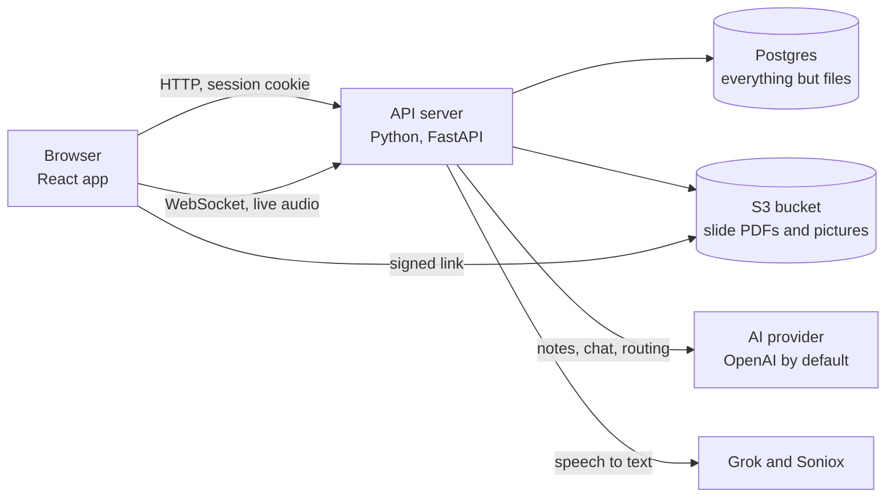
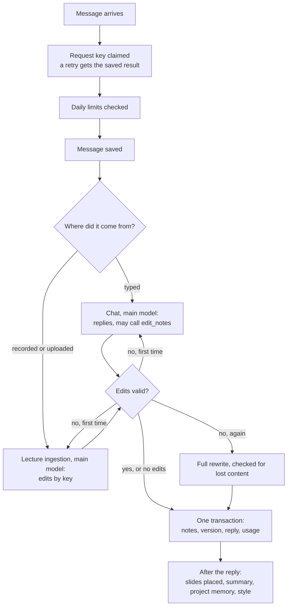
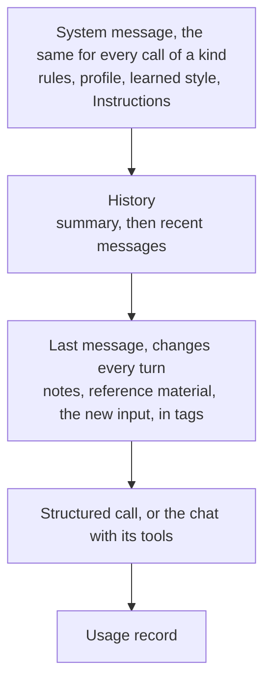
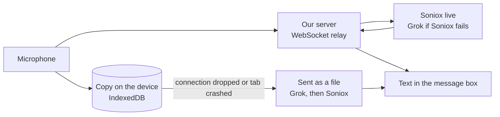
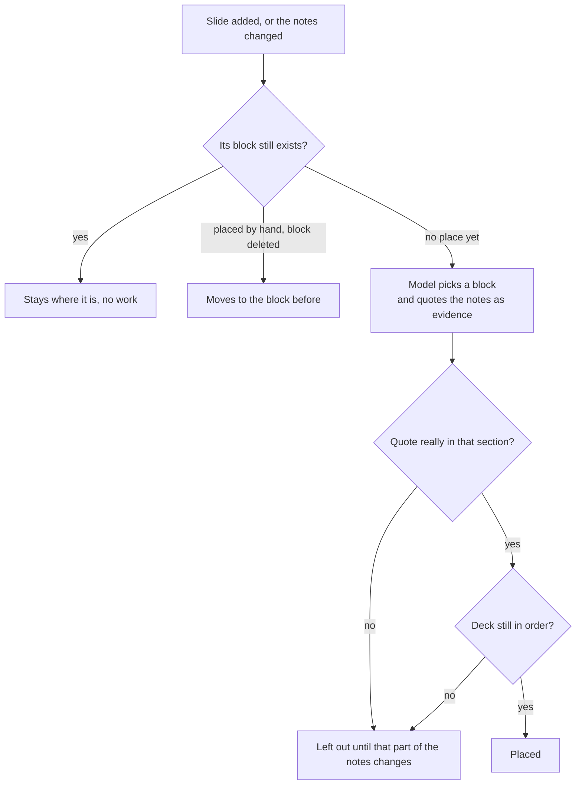

# Veda: design

How Veda is built and why. It goes through the system part by part: what each part does, the decision behind it, what
else could have been done, and what would change with many users.

Setting Veda up and running it is in the [README](README.md). What is planned is in the [roadmap](ROADMAP.md).

Paths are from the repo root: `server/app` is the API (Python, FastAPI) and `client/src` the browser app (React).
Diagrams are Mermaid, drawn by GitHub.

1. [What Veda is, and what makes it hard](#1-what-veda-is-and-what-makes-it-hard)
2. [Architecture](#2-architecture)
3. [How the notes are stored](#3-how-the-notes-are-stored)
4. [One turn, from message to saved notes](#4-one-turn-from-message-to-saved-notes)
5. [Working with AI models](#5-working-with-ai-models)
6. [Context and memory](#6-context-and-memory)
7. [Speech](#7-speech)
8. [Slides](#8-slides)
9. [Tools for the person](#9-tools-for-the-person)
10. [Accounts, security and limits](#10-accounts-security-and-limits)
11. [Reliability, operations and hosting](#11-reliability-operations-and-hosting)
12. [Quality: tests and evals](#12-quality-tests-and-evals)
13. [What breaks first at scale](#13-what-breaks-first-at-scale)

---

## 1. What Veda is, and what makes it hard

A student records a lecture live, uploads a recording, or pastes text. Veda writes study notes from it, and the
student keeps shaping them through a chat beside the notes: "add an example to the part on eigenvalues", "what did she
mean by the second condition?", "make this shorter". Some messages should change the notes; others should only get an
answer.

So each conversation has two things side by side: a **chat**, and **one living notes document** that the chat changes.
The document is edited many times, by many messages, over a whole course.

Five things make this harder than it looks, and most decisions below come from one of them:

1. **The input is long.** An hour of lecture is about 9,000 words (about 14,000 tokens), and a course is many hours.
   Sending everything on every message is slow and expensive, and models pay less attention to the middle of long text.
2. **Models make mistakes, and the notes must stay trustworthy.** A model asked to retype a document can silently drop a
   section, change a number, or add a "fact" the lecturer never said. In study notes, an invented fact is worse than a
   missing one.
3. **Every model call costs money,** and cost grows with the text sent and received.
4. **Calls are slow.** Writing notes from a long recording can take minutes, and the system must stay correct while it
   waits: the person can send another message, press a button on the notes, or close the tab.
5. **Not every message should change the notes.** "Thanks" and "what does this mean?" must leave the document alone,
   while "yes, add it" after Veda offered a change must change it.

---

## 2. Architecture



- **The browser app** (React, TanStack Router) shows the chat and the notes, records the microphone, keeps a copy of
  the audio on the device, and uploads slide PDFs whole for the person to add pages from the library.
- **The API server** (FastAPI) handles every request: it checks who you are, reads and writes the database, calls the
  models and the speech services, and returns the result.
- **Postgres** holds users, conversations, messages, the notes and their versions, slides, and a record of every model
  call and every minute of audio.
- **An S3 bucket** holds slide files (MinIO locally, Supabase Storage when deployed). The database keeps only their
  keys.
- **Outside services:** an AI provider writes notes and answers; two speech services turn speech into text, each the
  other's backup.

---

## 3. How the notes are stored

This is the central decision; most other parts depend on it.

### Keyed blocks

The notes are not one block of text. They are a **list of blocks**, where a block is one heading, paragraph, list
item, table, code block or formula, and each has a **key**:

```json
[
  {"key": "b1", "md": "# Electrostatics"},
  {"key": "b2", "md": "## Charge"},
  {"key": "b3", "md": "- Like charges repel."},
  {"key": "b4", "md": "- Opposite charges attract."}
]
```

The list is one JSON array in the conversation's `note_blocks` column (`jsonb`). **The order of the notes is the order
of the array**: there is no position column and no linked list. Keys are identities, not positions: after some edits
the list might read `b1, b2, b9, b3`.

When the model changes the notes, it sees them with their keys and answers with **edits that name keys**: replace
`b3`, insert after `b4`, delete `b5`. It never retypes the document. Code applies the edits, and every block not named
stays exactly as it was.

Two rules make keys useful:
- **A key is never reused.** `note_next_key` only goes up, so if `b5` is deleted, the next new block is `b6`, even after
  going back to an old version.
- **Everything that points into the notes points at a key:** a slide stores the key of the block it follows, a reply
  stores the keys it changed (for its "In your notes" links), and a selection is a list of keys. These pointers survive
  every edit that keeps their block.

### How a change is saved

1. **Lock** the conversation row (`SELECT ... FOR NO KEY UPDATE`), so two changes to the same notes go one at a time.
   This lock doesn't block inserts that only reference the row, like new messages.
2. **Read** the current list and version.
3. **Check** the change still applies. Edits name keys, so they usually still do after someone else's change. A full
   rewrite made from an older version is refused, because saving it would undo the other change.
4. **Apply** the edits to the list in Python. A replaced block keeps its key and place; if its new text is several
   blocks, the first keeps the key and the rest get new ones.
5. **Save** in one go: the whole new list, the rebuilt `note_content`, the version pointer, and a new `note_revisions`
   row with a full copy. Versions beyond the last 50 are deleted.
6. **Commit** with the rest of the turn: the reply and the usage records. All or nothing.

Postgres writes a new copy of the whole `jsonb` value on each update even if one block changed. For notes of tens of
kilobytes that is cheap.

### Decisions

**Why not store Markdown and ask for the new version each time?** That fails three ways:
1. **Silent damage.** Asked to retype a document with one change, a model sometimes shortens or rewords other parts.
   Each time it is small; over fifty turns it ruins the notes.
2. **Cost and time.** Output tokens are the expensive and slow ones. Retyping 3,000 words to change one sentence pays
   for 3,000 words of output.
3. **Nothing can point into it,** so slides and links would have no stable address.

**Alternatives considered.**
- **A diff or patch from the model.** Models are unreliable at exact line numbers and context lines, so patches often
  fail to apply. A short key like `b14` is easy to copy, and a wrong one is easy to report.
- **Search and replace.** The model must quote the old text exactly, which it gets wrong on long or formatted text, and
  two identical sentences are ambiguous.
- **One database row per block.** It would allow querying single blocks, which the app never does, at the cost of
  position columns, renumbering on inserts, and harder versioning. The notes are always read and written whole.
- **An editor's document format or a CRDT.** These solve real-time collaboration between people, which Veda doesn't
  have, and models write Markdown far more reliably than any editor's JSON.

**Validation and a guarded fallback.** Code checks every edit (`validate_edits`): every key named exists, no block is
named twice, nothing is inserted after a block the same answer deletes. Some changes ("reorganise this
chronologically") can't be expressed as edits, so the model may ask for a full rewrite: the only time the whole
document is written out, apart from the fallback after edits failed twice. That fallback is compared with the old notes
(`lost_content`) and refused if a heading disappeared or the text shrank below 80%. Because a new document is edits too,
no prompt has to ask the model to copy text it isn't changing.

**Versions are a pointer, not a stack.** Every change saves a full copy. Going back moves the pointer and puts that
copy in place: nothing is copied or deleted, so the person can go forward again. Full copies use more space than
differences but make going back instant, and keeping 50 bounds it.

**Slides live outside the notes.** The notes text never contains slide images; each slide stores the key it follows,
and images are added only when the notes are sent to the browser. If slides were in the text, the writer would have to
carry them through every edit and would sometimes drop or move them.

**`note_content` is a derived copy** of the blocks, kept because prompts and export read Markdown. The one save function
writes both.

---

## 4. One turn, from message to saved notes

A **turn** is one message from the person and everything until its reply is saved.



1. **Request key.** The browser sends a key with each send; a repeat of a finished send gets the saved result instead
   of a second turn (section 11).
2. **Limits.** Usage over the last 24 hours is checked first; over the limit is a 429 with a time to try again.
3. **Input.** An uploaded file is transcribed (section 7). Empty or oversized input is refused.
4. **Save the message** before any model is called.
5. **Two flows, by where the message came from.** The app knows a recording from a typed message (`source`), so it
   never guesses from the words.
   - **A recording or an upload** goes to the lecture ingestion: one call with the notes (as keyed blocks) and the
     recording, no chat history, that returns edits, `logistics` and `off_topic`. A recording asks for nothing: no
     edits means nothing was worth noting, and `off_topic` (another subject arriving in existing notes) leaves the
     notes alone and offers to add it, which a typed "yes" then does.
   - **A typed or dictated message** goes to the chat: one call that replies, with the notes (keyed), the recent chat
     and the message, and three tools it may use or not. `edit_notes` changes the notes (a new document included:
     inserts at the top), `read_lecture` fetches the parts of the lecture a question is about, and `set_title` names a
     new conversation. A call ends when the model replies without a tool; at most 4 calls a turn.
6. **One change per turn.** Edits are checked, then applied as one version when the turn is saved. Reorganising the
   whole document (`restructure`) goes to the full-document writer.
7. **Validation, one retry, guarded fallback** (section 3).
8. **Save** everything in one transaction, under the short row lock.
9. **After the reply:** a hand-placed slide whose paragraph was deleted moves to the one before it at once; slides
   that need a new spot are placed by the model after the response (section 8), so the reply never waits for them.
   Background jobs also update the chat summary, the project's memory and the learned style.

### Decisions

**No router: an optional tool.** Most messages ("thanks", "what does this mean?") must not touch the notes. A router
(a cheap model deciding first) used to stand between them and a writer, because a model handed a "produce the
document" contract nearly always produces one. A tool the chat may call carries no such pressure, and one call that
both decides and replies is simpler and sees the whole conversation, so "yes" after an offer just works. The risk is
the other way, changing the notes when it should only answer, so the chat prompt lists when not to call `edit_notes`
(a question, a question about whether something belongs, another subject, small talk) and `scripts/eval_router.py`
measures exactly that, against the router's old 97%. Recordings never needed deciding: a lecturer saying "remove that"
is not asking for anything.

**"Yes" after an offer.** The chat sees the previous turns. If the earlier message was a long lecture that wasn't
added, the whole of it comes with the "yes", not the clipped copy in the chat history.

**One retry, not three.** Each retry is another expensive call. One retry with the exact reason ("key `b40` does not
exist") fixes the common mistakes; failing twice usually means edits can't express the change, which is what the
guarded rewrite is for.

**Optimistic concurrency with a short lock, not a lock for the whole turn.** A turn can take minutes, during which the
person may press a button on the notes or go back a version. Locking the notes for the whole turn would make those wait
minutes, and holding a database lock across a slow outside call is a classic mistake. Instead the turn remembers the
version it read, locks only while saving, and re-checks. "Last write wins" was rejected because it silently loses the
other change.

**A failed turn is undone completely.** If anything fails, the user message is deleted again, the browser puts the
text back in the box, and the chat looks as it did. Model calls that did finish are still recorded, since they were
paid for. An upload's transcript is kept as the draft, so it isn't paid for twice.

**The server's deadline is shorter than the browser's.** The model work must finish within 10 minutes (block actions:
8); the browser waits 15 (block actions: 10). So the server always settles the outcome, saved or undone, before the
browser gives up.

---

## 5. Working with AI models

Every model call goes through the same pieces:

- **One interface for every provider.** LangChain's `init_chat_model` builds a client from a string such as
  `openai:gpt-5.6-luna`. Only OpenAI is installed; adding another provider is its LangChain package and a key setting.
- **Two tiers.** The main model (`LLM_MODEL`) does the chat, the lecture ingestion and block actions. The cheap model
  (`ROUTING_LLM_MODEL`) does the chat summary, project memory, style learning, slide placement and the profile.
- **Structured output, and tools for the chat.** Every call but the chat asks for a typed object (a Pydantic class such
  as `LectureUpdate`), and the provider is constrained to that shape. The chat replies in plain text and may call
  tools, whose arguments are checked against Pydantic classes too. Code checks content, never parses format.
- **A fallback model on outages only.** `FallbackChat` moves to a second model on a 5xx, a connection error or a
  timeout. A 4xx (bad input, rate limit) is raised: the second provider would likely refuse it too, and passing it on
  would hide a real problem.
- **The chat through the Responses API.** OpenAI's chat completions refuse tools on `gpt-5.6-luna` while it reasons, so
  the chat alone goes through its Responses API, reasoning at `low` effort (`CHAT_RESPONSES_API`,
  `CHAT_REASONING_EFFORT`). Without reasoning it decided worse when to change the notes (0.90 against the router's
  0.96 on the decision eval). Same model and price per token; the reasoning tokens are billed as output.
- **Time limits:** 60 seconds for the cheap model's jobs, 240 for the main model.
- **A usage record per call:** tokens in, out, cached and reasoning, which model answered, and the prompt version.

### The prompt



**A briefing, not a list of patches.** Each prompt says who reads the notes and what the job is, gives the judgement
calls, and shows one worked example (the ingestion: a recording folded into two blocks plus a logistics line; the chat:
read, offer, edit). Rules exist only for failures that were seen, each named in a comment beside it, and only where
code cannot do the job: the logistics box, the LaTeX delimiters and the edit checks are code. Shortened this way, the
chat and ingestion prompts went from about 2,700 and 2,400 words to about 1,500 each; whether that cost anything is
what the evals measure (`--baseline`).

**Laid out for caching.** Providers reuse their work on a prompt that starts exactly like a recent one, billed at a
large discount; the match ends at the first character that differs. So what never changes goes first, and what
changes every turn goes last. On block actions, about 6,300 of 6,310 input tokens came from the cache once warm.
`server/scripts/cache_report.py` shows the hit rate per kind of call.

**Fenced material against prompt injection.** Anything from a lecture, an upload or a slide could contain "ignore your
instructions". Every piece of material is wrapped in tags (`<lecture_input>`, `<summary>`, `<notes>`, `<lecture>`,
`<slides>`, `<project_memory>`), a closing tag inside the material is broken up so it can't end its own fence, and the
rules say tagged text is material, never instructions. What the person typed or dictated in the chat is `<request>`
instead: it directs the work (any change, a language, a tone), but text they paste into it is still material, and
nothing can change the rules or the output fields. The page says whether the text in the box came from a recording
(`source`), and each message keeps it, so earlier turns are tagged the same way; messages from before then count as
material. A precedence list in the system prompt settles conflicts: the rules, then the current request, then the
project's instructions, the person's own, the learned style, and the defaults. The chat's tools only change the notes,
read the lecture or set the title, so the worst an injection can do is a bad edit, which validation limits and undo
reverses.

**What goes in the notes.** The writer prompts share rules on content, not just format: study notes, shorter than the
lecture but never a summary. Keep definitions, the reasoning behind each point, distinctions, rules with their
conditions, steps, formulas with every symbol explained, examples that teach, and **Common trap:** bullets. Leave out
polls, asides, repeats, demonstrations that teach nothing, and what the lecture calls out of scope. Each idea once. Only
what the lecture said: a worked example is added only when the lecture gave one or the person asks. Logistics a student
must act on (when labs start, what is given on tests) come back as a separate `logistics` list, and code keeps them in
one "Course logistics" box at the top of the notes (`services/notes/logistics.py`): an exact format is code's job, not
the prompt's. A box the model writes itself anyway, in any wording, is taken out of its edits and merged into the one
box, and notes that already have two are merged the next time they change.

**An automatic prompt version.** Each kind of call gets a short fingerprint: a hash of its fixed prompt, its schema and
the source of the functions that build its messages. It is stored on every usage record and eval result, so nobody has
to remember to bump a version, and an old eval baseline is never mistaken for a fair comparison.

**Plain functions, no graph.** The turn was a LangGraph graph (router, then writer or chat). With two flows chosen by
the message's source and no router, it is two plain functions (`notes_graph._chat`, `notes_graph._write_notes`).

---

## 6. Context and memory

A model knows only what is in its prompt. The aim is a prompt small enough to be cheap and focused, that still holds
what the answer needs.

| What the model gets | How it is chosen |
| --- | --- |
| Recent chat | The last 8 messages; the 2 newest up to 6,000 characters each, older ones up to 800 |
| Older chat | A summary, refreshed in the background as messages leave the window |
| The notes | The whole document with keys for the chat, the lecture ingestion and block actions |
| The lecture | For the chat when it calls `read_lecture`, and for block actions: the most relevant parts, up to a budget (below) |
| The person | A compiled profile, their own Instructions, and learned style habits |
| The project | Its Instructions, its glossary, and one sentence on what each of its other chats covered |

**The notes are the memory, not the chat.** Old messages are summarised rather than resent, because what they taught
is already in the notes; the summary keeps requests, preferences and open questions.

### Finding the relevant parts of a lecture

Chat answers get up to 6,000 tokens of the lecture, and block actions up to 25,000 (`LECTURE_CONTEXT_TOKENS`). A
lecture under the budget is sent whole. A longer one is narrowed down (`services/ai/lecture.py`):

1. Cut the lecture into pieces of about 1,500 characters, at sentence ends.
2. Score each piece by the words it shares with the question or the selected blocks, each word weighted by how rare it
   is in the lecture (the IDF in TF-IDF), so "Coulomb" counts far more than "charge".
3. Take the best pieces until the budget is full, then put them back in lecture order, with `[…]` where something was
   left out.
4. If nothing matches, send pieces spread evenly and say so. A chat message with no word in common with the lecture
   ("thanks") gets no lecture at all.

**Why word overlap and not embeddings.** Embeddings need a model call per piece and per question, somewhere to store
vectors, and a way to keep them in step. Questions about a lecture usually reuse its own terms, which word overlap finds
at no cost. Its weakness is paraphrase ("the stretching thing" for "eigenvector") and misheard terms.

**A smaller budget did as well.** Block actions used to send up to 120,000 tokens of lecture. On the long-lecture eval
cases, 25,000 scored the same and cut input tokens by 38% (about 23,000 instead of 37,000 per call). More context is
not better context.

### Learning in the background

After a reply, up to three jobs run on the cheap model:
- **Project memory** adds new terms to the glossary and rewrites this chat's summary: one short sentence naming its
  topics. The writer of every other chat in the project is given those sentences, with the chats' titles, so the chats
  have context on one another (what an earlier lecture covered, the terms it used). It is never shown in the app.
- **Style habits** infer rules such as "prefers short bullets" from what the person does, and only that: short typed
  requests (not recordings or uploads), which buttons they use on the notes (Expand, Simplify, Remove...), and which
  AI changes they undo. Never from the notes themselves: the AI wrote them, so learning from their look only taught it
  its own style back. A rule needs two supporting signals (or one explicit request) before it reaches the prompt, and
  there are at most 8.
- **Chat summary** folds messages that left the window into the summary.

The person sees the style habits in Settings, Memory, and can reword or remove any. What they wrote or dismissed is
never changed or relearned by the AI. A word they fix in the notes joins the project's glossary the same way.

**A version check, not a lock.** Each job reads the row and its version, calls the model (seconds), then writes only if
the version is unchanged (`UPDATE ... WHERE version = <the one read>`). A lock across the model call would block other
writers; the worst case here is a skipped update, redone on the next turn.

**No job queue for this.** FastAPI's `BackgroundTasks` runs the jobs after the response, in the same process. A job in
progress when the server restarts is lost, which is acceptable because the next turn redoes it.

### The profile, Instructions and language

- **The profile** is a short form. A cheap model compiles it into a paragraph for the prompt; the paragraph is never
  returned by the API, so the person controls their answers, not a paraphrase.
- **Instructions** the person types go to the writer word for word (up to 600 characters), behind a guard saying they
  shape style and can't override the rules. They skip the compiler, which would turn directives into description.
- **Language** is chosen in Settings and sent to the speech providers (section 7).

---

## 7. Speech



**Live recording on a computer.** The browser records small compressed chunks a few times a second and sends them over
a WebSocket to our server, which relays them to Soniox's live endpoint (Grok's when Soniox fails) and relays the text
back. Every chunk is also saved on the device. If the connection drops, recording continues on the device, and at Stop
the missed stretch is sent as a file and its text put back where the gap was.

**Recording on a phone.** No live connection: phones lose signal, switch networks and lock their screens. The
recording is cut into 3-minute pieces; each is sent as a file as it ends, in order, and its text is kept hidden until
Stop, when the whole transcript appears at once. Pieces wait on the device when offline.

**Uploads.** ffmpeg converts any audio or video to small mono speech audio (16 kHz, 32 kbps, about 14 MB an hour).
Recordings over 60 minutes are cut at the quietest moment near each 60-minute mark, so no word is split. Grok
transcribes each file in one request; Soniox, the backup, keeps files until deleted, so each is deleted as soon as its
text is read. Phone pieces and live gaps take the same path.

### Decisions

**A relay through our server, not a direct browser connection.** A direct connection would put the provider's key in
the page. The relay keeps the key secret, checks the session, enforces the daily audio limit (usage saved every 60
seconds, so two recordings share one allowance), and records usage. The socket:
- refuses a page from another site by checking the `Origin` header, since CORS doesn't cover WebSockets;
- accepts first and then closes with **4401** when signed out (refused at the handshake, the browser would only see
  1006 and keep reconnecting), and **4429** at the daily limit.

**Two providers, each the other's backup.** Files go to Grok first (about $0.10 an hour, fewer word errors, and the text
comes back in the same request); live goes to Soniox first ($0.12 an hour against Grok's $0.20, and it takes the
browser's audio as it is). A failure moves to the other, and a provider that just failed is skipped for a minute. The
order is a setting. The app started on a single provider whose live price would have cost a heavy user more than the
app's intended price; two cheaper providers also remove the single point of failure. The cost is two integrations,
and Grok live needs the audio converted to raw PCM on the way.

**A copy of the audio on the device.** A lecture can't be repeated. IndexedDB keeps every chunk, so a dropped
connection or a crashed tab loses nothing that is still on the device. Keeping audio in the browser avoids the storage
and privacy questions of keeping lecture audio on a server. Copies are removed once their text is sent, after a week,
and on sign-out.

**When a part still can't be transcribed.** At Stop, missed stretches are retried one at a time and put back in
order. A stretch that still fails leaves a marker in the text where it goes, "[3:00–6:00 not turned into text yet]",
and its audio stays on the device even after Send. A banner above the box offers **Fill in**, which sends only the
missing parts and puts each one in place of its marker (or, if that text was already sent, adds it at the end under its
time). A recording cut short by a closed tab is offered as **Recover**, which transcribes the whole recording.

**What the providers are told.** Each recording carries:
- **the person's language** (Settings, 25 choices; English by default). For Grok it sets how numbers and units are
  written; for Soniox it is a hint;
- **the project's glossary,** so a course's terms are heard right;
- **the last 30 headings of the conversation's notes,** the lecture's topics so far.

Grok gets the terms then the headings as key terms (up to 100); Soniox gets them as context.

**Fixing a misheard word is a text replacement, not a model call.** The writer marks words it couldn't make out with
`[?]`. The person types the right word and it is replaced everywhere as a whole word: exact, instant, free, and saved
as a version. In a project it also joins the glossary.

**The draft is saved in appended pieces.** During a long recording the draft grows to tens of thousands of characters;
rewriting it whole every second would get slower and slower. Each save appends only the new text as a row.

---

## 8. Slides

The person uploads a deck. PowerPoint, OpenDocument and Keynote are converted to PDF by LibreOffice and sent back
without being stored; the conversion starts as soon as the file is chosen, while the person confirms it. The person
confirms the file and the whole PDF is uploaded; nothing goes in the notes yet. The
slides library then opens, and the person adds the pages they want from there. Each included slide then needs a place:
**after which block?**



**Placement by key.** A slide stores the key of the block it follows, so a placed slide stays put through every edit
that keeps its block, at no cost. Only slides with no place reach the model, and a slide placed by hand is never moved
by the AI.

**The evidence check.** A deck often runs ahead of the lecture. Asked to place all 40 slides, the model put next week's
slides under the last section it recognised, because it was asked to choose. Now it must back each placement with a
short quote from the chosen section, and code checks the quote is really there. A rule in the prompt allowing "no
place" hadn't been enough; a check in code can't be argued with.

**Two placement algorithms.** The default sends unplaced slides to the main model, with evidence. The alternative
("hybrid") scores slides against blocks with TF-IDF, keeps slides in order with dynamic programming, and asks a cheap
model only when unsure. It was cheaper but less accurate on the placement eval (90% exact against 100%), so the
simpler one stays the default.

**Deck order is enforced in code.** An earlier page of a deck may never sit after a later page of the same deck
(`keep_deck_order`, after every placement, whichever algorithm). Pages under the same paragraph are fine: they show in
page order. A slide placed by hand is never moved and bounds the AI's slides around it. Of the AI's slides, the
largest set in order is kept, an already placed slide counting double against a new answer; the rest are left out like
a slide the notes don't cover, and asked about again after the next change. Without it, an earlier slide could land
after a later one: the batches are asked without seeing each other's answers, and the model gets order wrong.

**Placed after the response.** Placing a long deck took about 40 s, all of it waiting on the model, and the person
watched a loader; a reply that left a slide without its paragraph waited too.
- **Now:** a change commits first. The quick part runs at once (`schedule_slide_placement`: hand-placed slides move,
  with no model call). If any slide needs a spot, the conversation's `slides_placing_since` is set, and
  `place_slides_job` runs after the response, with its own session.
- **The guard:** it saves under the same version check as everything else: if the notes changed meanwhile, the
  placement is dropped and the newer change settles the slides itself. It clears the flag only if the flag is still
  its own, so an older job never clears a newer one's.
- **The page:** every notes view carries `slides_placing`. While it is true, the conversation page reads the notes
  again every 2 seconds and stops once the flag clears, after 3 minutes, or when the person leaves the conversation.
  An answer older than the notes already shown is ignored. A flag older than 5 minutes is from a job that died (a
  restart), and counts as nothing being placed.
- **Why polling, not a pushed event:** placement is short (about 10 s) and rare, polling reads the database every
  process shares, and it recovers from a dropped connection by itself. When replies stream, "slides placed" can ride
  on that connection instead.

**Faster placement.**
- **The batches run together.** The model is asked about 20 slides at a time, so a long deck is several requests.
  They run at once, four at most (`PLACEMENT_CONCURRENCY`), instead of one after another (about 37 s down to about
  10 s for 77 slides). Each batch is asked exactly what it was before: the "already placed" context is built once.
- **Pictures are drawn in parallel.** A slide added to the notes gets a full-size picture. These are drawn in a few
  separate processes (`slide_pdf.render_images_parallel`), not one page at a time on one core (about 4.5 s down to 2 s
  for 77 pages). Processes, because PyMuPDF must not be used from several threads. `slide_pdf.py` imports nothing of
  the app's, so a process starts quickly; if they can't start, the pages are drawn in one.

**Not asking again.** A slide left out stores a fingerprint of what it was compared against (hybrid placement), and
isn't sent to the model again until that part of the notes changes.

**Files in a private bucket.** Only the PDF and the pictures of included pages are stored. The browser gets a link that
expires, made after the API checked the slide is theirs, so picture traffic never passes through the server.

**Licensing.** PyMuPDF, the PDF library, is AGPL-3.0: a closed commercial service would need a paid licence or another
library.

---

## 9. Tools for the person

**Block actions.** The person selects blocks in the notes and chooses Simplify, Expand, Add an example, Regenerate, or
writes their own instruction. The model gets the whole notes with keys, the relevant parts of the lecture (section 6)
and the action's rules, and returns edits. Code checks every edit stays inside the selection (`validate_scope`): an
edit outside it is refused with the reason, the model gets one more try, and then the action fails with the notes
untouched. An empty answer can be right: if the lecture says nothing more about a paragraph, Expand leaves it as it is
and says so, rather than inventing. Block actions count as turns for the daily limits.

**Versions.** Every change from any source is a version with a label ("Simplified selected text", "Fixed a word"). The
person can preview any of the last 50 and go back. Going back over an AI change within 10 minutes records it as undone,
which feeds style learning.

**Flagging a wrong reply.** Marks the reply and the usage records behind it; a script turns recent flags into draft
eval cases.

**Export.** Markdown, a zip with the slide pictures (opens as-is in Obsidian), or a PDF through the browser's print
dialog, since the browser has already rendered the maths and diagrams.

**Find in notes.** A search field in the notes' header, next to collapse (Ctrl/Cmd+F goes to it once the person is in the notes),
entirely in the browser: case and accents ignored, each match marked by a padded box in a layer over the notes
(blended, so the words show through) so the notes' own markup is never changed. Formulas and diagrams are not searched.

**Rendering.** Markdown with tables, LaTeX (KaTeX) and Mermaid diagrams. Common model mistakes in maths are repaired
both when written and when displayed; a broken diagram shows its source and a broken equation renders red, never
nothing.

**Layout.** Until a conversation has notes, the chat is the main card in the middle. Once it has notes, they take the
middle and the chat moves into a panel on their right that can be resized (by its left border) and folded away; the
slides library opens in that panel too. On a narrow window the sidebar and the chat panel become drawers over the
notes. The chat is never unmounted when it moves, so a half-typed message or a recording survives. The layout is
computed from the window size, not measured from the page, which would feed back on itself.

**On a phone.** Once there are notes, a switch at the bottom moves between the notes and the chat, and a round
button over the notes opens the chat and starts recording (showing the time while it records).

**Look.** Every surface (a card, a dialog, a menu, the composer) has the same rounded corners, and what sits inside
one a slightly smaller radius. In dark mode cards are a shade lighter than the page, and menus a shade lighter again.
A chat that is loading shows its shape; a page that fails to load, or isn't there, says so with a way on
(components/page-states.tsx).

---

## 10. Accounts, security and limits

**Invite only.** Accounts are created by hand; there is no public sign-up.

**Sessions.** Signing in creates a random 32-byte token, stored for 30 days and sent as a cookie: `httponly`,
`samesite=lax`, and `secure` outside development. Every request checks it with one query that joins the session to
its user and keeps it only while in date. Expired sessions are refused, and deleted at each sign-in and when the app
starts.

**Opaque tokens, not JWTs.** A JWT can be trusted without a database lookup, but can't be revoked before it expires
without a deny list, which is a lookup again. A database token is ended by deleting its row, for one indexed query per
request.

**Ownership.** One module (`api/ownership.py`) decides whether something is yours. Someone else's conversation, project
or slide is a **404**, never a 403, which would confirm the id exists. `tests/integration/test_tenancy.py` walks every
route as a second user.

**Limits.** Each person has limits over a rolling 24 hours on turns, tokens and minutes of audio. They are sums of the
usage records, so there is no counter to drift or reset at midnight, and no price table to go stale. Work the app does
by itself is recorded but never counts.

**CORS and the socket's Origin check.** The browser app and the API are on different origins. The API allows the
origins listed in `CORS_ORIGINS` (in development also this machine and the local network, for phones on the same
Wi-Fi). The recording socket checks `Origin` against the same rule itself.

---

## 11. Reliability, operations and hosting

### A retry can't do the work twice

The browser makes a **request key** for each send and block action and reuses it when the person retries. The server
claims the key before any paid work: a repeat after the work finished gets the saved result; a repeat while it runs
waits for it; a key left running for 30 minutes is taken over. The key is finished in the same transaction as the work,
and released on failure. Without it, a network blip plus "Send again" gave two replies and paid twice.

### Deploys, health checks and logs

- **Graceful shutdown.** On a stop signal the server stops taking requests and lets those in progress finish, for up
  to 11 minutes (a reply can take 10). The host's stop timeout must be at least that long.
- **Two health checks.** `/health` says the process is alive without touching the database; `/health/ready` checks the
  database. Restart on the first and route traffic on the second: with one check, a database blip would make the host
  restart the server and kill every reply in progress.
- **Request ids.** Every request gets an id that appears on every log line it causes and on the response, so a failure
  seen in the browser or in Sentry leads straight to its logs. One summary line per request gives its time and its
  number of database queries.
- **Sentry,** when configured, receives errors with request bodies, cookies, local variables and AI text stripped.
- **ffmpeg and LibreOffice run at low priority,** so the server's own work goes first on a busy core.

### Workers and database connections

The API runs several processes (`WEB_CONCURRENCY`, default 4). Most routes are plain functions that FastAPI runs on a
thread pool. Ten are asynchronous (sending a message, block actions, uploads, a few slide routes, the live socket), and
they and the learning jobs make database calls on the event loop, so a slow database round trip holds up that process.
Locally a round trip is under a millisecond; far from the database it can be tens. `server/scripts/db_latency.py` and
the per-request summary line say whether moving those calls onto threads is worth doing.

Each process keeps its own pool of open database connections, reused between requests (up to 15 per process, so 60 for
the API). A managed Postgres caps connections (around 60 on small Supabase plans), so in production the app should use
the pooled address and migrations the direct one, or smaller pools.

### Migrations

Schema changes are numbered Alembic files, reviewed and kept in git. In development the app migrates itself at
startup, under a Postgres advisory lock so only one process does it. In a deploy, `python -m app.migrate` runs once
before the new version starts, so several instances never race on the schema. The app refuses to migrate a database
that has tables but no Alembic version: that means the settings point at someone else's database.

### No job queue, yet

Everything runs in the API process. A turn runs inside its request; follow-up jobs (summary, memory, style, slide
placement) run after the response; slide conversions wait their turn in a per-process limit. The risks a queue would
solve are covered more cheaply for now: request keys stop duplicates, graceful shutdown lets replies finish on deploys.
A crash mid-turn loses that turn, and the person sends again.

A queue becomes worth building when one of these happens: the host can't keep a request open for 10 minutes; lost
replies after restarts become noticeable; spikes (many lectures ending at once) hit the AI provider's rate limits; or
the AI work should run on separate machines. Then a **`jobs` table in Postgres** is enough: sending a message saves a
job and returns its id, workers claim jobs with `SELECT ... FOR UPDATE SKIP LOCKED` (each takes a different job, none
twice), run the existing turn code, and save the result; the page checks the job's status. Jobs stuck "running" too
long are put back, and request keys already make a job safe to run twice. A queue needs a host that runs processes
continuously, which rules out serverless.

### Hosting

The plan: the browser app on Vercel, the database and slide files on Supabase, and the API in a container on a host in
the same region as Supabase. The API host must:
1. **keep a request open about 10 minutes,** since a turn runs inside its request;
2. **keep WebSockets open for an hour or more,** for live recording;
3. **wait 11 minutes on a stop,** so deploys let replies finish.

From the hosts' own forums (to confirm on their documentation): Railway allows 15-minute requests, has no WebSocket
time limit, and has an adjustable shutdown wait, so it meets all three. Render meets the first two but caps the
shutdown wait at 5 minutes without support. Fly closes a connection after 60 seconds with no data sent, which a turn
would hit, and so would need the queue.

**Releasing a version:** build the image from the root `Dockerfile`, run `python -m app.migrate` once against the
database, then start the new version, with `ENVIRONMENT=production`, the keys, `CORS_ORIGINS`, and the storage
settings for a private Supabase bucket.

---

## 12. Quality: tests and evals

Tests check that the code does what it should. Evals check that the AI does a good job. Veda needs both, because most of
what can go wrong is in the second.

| Layer | What it checks | How |
| --- | --- | --- |
| Server unit tests | Pure logic: edit validation, audio cutting, lecture scoring, prompts | pytest, nothing outside the code |
| Server integration tests | Endpoints, database rules, ownership, concurrency, storage | The API in process, a real Postgres and MinIO |
| System tests | The whole server over real HTTP | A test copy of the stack with a fake model |
| Browser unit tests | Client logic: drafts, recording storage, layout maths | Vitest |
| Browser journeys | A person's main journeys end to end | Playwright against the test stack |
| Evals | Quality of notes, routing, chat, block actions, slide placement, learning | Real models, a judge model, baselines |

About 1,300 server tests, 218 browser unit tests and 18 Playwright journeys run in GitHub Actions on every push and
pull request. The server tests cover 96% of the server's lines.

**A real Postgres, not SQLite.** The app relies on binary JSON, row locks that don't block related inserts, and advisory
locks; SQLite would pass tests that fail in production.

**The model is faked at the network edge.** The system and browser tests point the OpenAI client at a small fake server
(`server/tests/system/llm_stub.py`) that answers each structured call with a canned answer chosen by the schema's name.
Mocking a function instead would skip the code that builds requests and reads responses, which is where bugs hide.

**Few browser tests.** They are slow and break when a button moves. There are one or two per journey (sign in, record,
send, act on blocks, slides, versions, the phone layout), and logic is tested lower down.

**Evals with a judge.** Each eval runs hand-written cases through the real models. Code checks what it can (do the edits
apply? was the routing right?). A second model, the **judge**, answers narrow questions code can't: which expected facts
are in the notes, which earlier facts survived, and what the notes claim that the lecture never said. There are 124
cases in all, 45 of them judged. Each case can run several times and be averaged, since one run is noisy. A **baseline**
records the scores with their prompt versions, and a run fails if a score got worse. Evals cost money, so they run by
hand on prompt or model changes, never in CI (`server/scripts/eval_*.py --yes`).

---

## 13. What breaks first at scale

In the order we'd expect to hit them:

1. **Long requests.** Turns hold an HTTP request for minutes, which some hosts and proxies cut off. Fix: the Postgres
   job queue (section 11), and streaming replies so they feel faster.
2. **Provider rate limits.** Many lectures end on the hour. Fix: the queue to smooth bursts, backoff, more keys or
   providers (the fallback layer exists). Soniox's 10-live-recordings default must be raised before launch.
3. **Database calls on the event loop.** A slow round trip stalls other requests on that process. Fix: move those calls
   onto threads, once `db_latency.py` says it matters.
4. **Database connections.** Fix: the managed pooler and smaller pools.
5. **Background work in the web process.** Lost on restart, and competing with requests. Fix: the same queue.
6. **Audio and slide processing.** ffmpeg and LibreOffice are CPU-heavy. Fix: their own workers.
7. **No trace of exact prompts and answers.** Usage rows record cost and prompt version, not content. Fix: a tracing
   tool (Langfuse, managed or on separate servers, never on the app's machines).
8. **Limits summed from rows.** Fine now; at high volume a daily rollup table or a counter replaces the sum.
