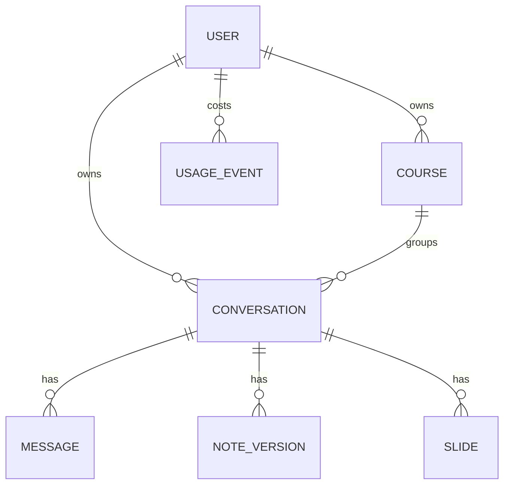
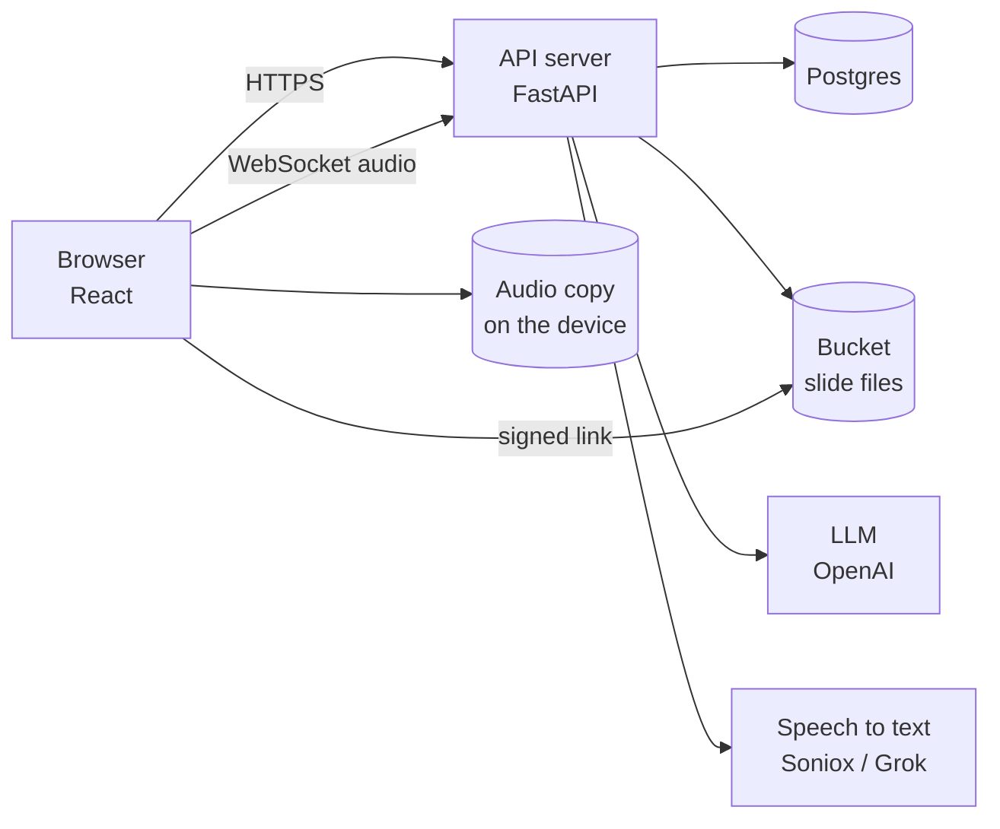
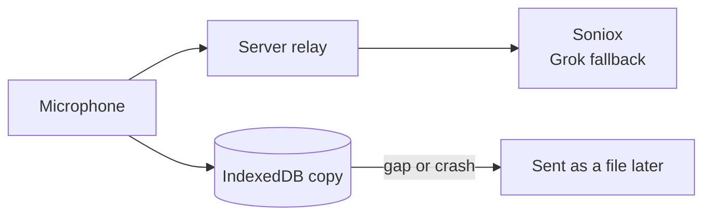

# Veda: system design

Veda turns lectures into study notes and lets students shape them by chatting. This document walks through its design in
the usual interview order: requirements, entities, API, high-level design, then deep dives.

Setup is in the [README](README.md). A shorter tour is in [DESIGN-PUBLIC.md](DESIGN-PUBLIC.md).

---

## 1. Functional requirements

**Core.** Users should be able to:

1. Record a lecture live (computer or phone), upload a recording, or paste text, and get study notes from it.
2. Change the notes by chatting ("add an example", "make this shorter"), or ask questions that leave them alone.
3. Act on selected parts of the notes (Simplify, Expand, Add an example) and undo any change.
4. Add slides from a deck and have them placed next to the right part of the notes.
5. Group lectures into a course, so each lecture's notes and answers know the rest of the course.

**Out of scope:**

- Several people editing the same notes at once.
- Native apps (the phone experience runs in the browser).
- Keeping lecture audio on the server.

---

## 2. Non-functional requirements

1. **Trustworthy notes.** An AI edit must never silently drop, change or invent content elsewhere in the notes.
2. **No lost lectures.** A lecture can't be repeated, so a dropped connection or a closed tab must not lose audio.
3. **Correct while work is in flight.** The user may press a button on the notes or restore a version while a turn
   runs, and a retry must not do the work (or bill it) twice.
4. **Low cost per user.** Model and speech costs grow with usage, so every call should send only what it needs.
5. **Fast.** Replies and notes in seconds, even from a two-hour lecture.
6. **Private.** A user can only ever reach their own data.

The trade-off: **correctness over latency.** Waiting a few seconds longer is fine; damaged notes are not.

---

## 3. Back-of-the-envelope

Only the numbers that shape the design:

| Quantity | Value | Consequence |
| --- | --- | --- |
| One hour of lecture | ~9,000 words, ~14,000 tokens | Too big to resend on every message: send only relevant parts |
| Notes for one lecture | Tens of KB | Cheap to store whole as JSON and copy per version |
| Versions kept | 50 per conversation | Full copies stay bounded (about 1–2 MB per conversation) |
| Upload audio after conversion | ~14 MB per hour | Long files must be split before transcription |
| A turn | ~5–10 s, even for a 2-hour lecture | Fine inside one HTTP request. The 10-minute cap is only a worst case |
| Speech to text | ~$0.10–0.12 per hour | Speech is a real share of the cost: pick the cheaper provider per use |
| Peak load | Many lectures end on the hour | Bursts of long AI calls: the first thing to queue at scale |

---

## 4. Core entities



- **User**: account, profile, learned style habits, language.
- **Course** (a project): instructions and a course memory (glossary, one line per lecture).
- **Conversation**: one lecture. A chat plus **one notes document**, stored as a list of keyed blocks.
- **Message**: what the user sent (typed, recorded or uploaded) and the AI's replies.
- **Note version**: a full copy of the notes after each change.
- **Slide**: a page of a deck, and the key of the notes block it follows.
- **Usage event**: one model call or stretch of audio, with its tokens and cost. Daily limits are summed from these.

---

## 5. API

REST over HTTPS with a session cookie, plus one WebSocket for live audio. The main endpoints:

```text
POST   /auth/sign-in                          -> session cookie

POST   /conversations                         -> Conversation
GET    /conversations/{id}                    -> messages, notes, slides
POST   /conversations/{id}/messages           -> reply + updated notes      (one "turn")
         form: transcript | file, source, block_keys, request_key
WS     /ws/transcribe?conversation_id=        audio in, text out            (live recording)
POST   /conversations/{id}/transcribe         audio file in, text out       (phone pieces, gaps)

POST   /conversations/{id}/notes/actions      {action, keys, base_revision, request_key}
GET    /conversations/{id}/notes/versions     -> version list
POST   /conversations/{id}/notes/restore      {seq}
GET    /conversations/{id}/notes/export       ?format=md|zip

POST   /conversations/{id}/slides/decks       PDF in
PATCH  /conversations/{id}/slides             {add, remove, place}

POST   /projects                              -> Course
GET    /projects/{id}/memory                  -> glossary + lecture summaries
```

Notes on the API:

- **The user comes from the session, never the request body.** Someone else's resource is a 404, not a 403, so ids
  can't be probed.
- **Writes that cost money carry a `request_key`,** so a retry returns the saved result instead of running again.
- **Edits carry the version they were based on** (`base_revision`), so a stale edit is detected, not applied blindly.

---

## 6. High-level design



One API service (a modular monolith), several identical copies behind a load balancer. One service means **one
database transaction around a whole turn**: the reply, the notes change, the version and the usage are saved together
or not at all.

Walking through the requirements:

**1. Lecture to notes.** The browser streams microphone audio over the WebSocket. The server relays it to the speech
provider and streams text back into the message box. On Send, the transcript goes to `POST /messages`. The server
gives the model the current notes (as keyed blocks) and the transcript, and gets back **edits by key**, which code
applies and saves as a new version.

**2. Chat.** A typed message goes to the same endpoint. Because the app knows where the text came from (`source`), a
typed message goes to the chat instead of the notes writer. The chat replies, and may call tools: `edit_notes`,
`read_lecture` (relevant parts of the transcript), `read_course` (other lectures' notes) and `set_title`.

**3. Block actions and undo.** The user selects blocks and picks an action. The model gets the notes and the relevant
lecture text and returns edits, which must stay inside the selection. Every change from any source is a version;
restoring moves a pointer.

**4. Slides.** The PDF goes to the bucket; pages are rows in Postgres. Each added slide is placed after a block, by the
model, after the reply is sent. The browser polls the notes until placement is done.

**5. Courses.** After a turn that brought lecture material, a background job updates the course memory (new terms, a
one-line summary). Every other lecture in the course gets that memory in its prompt, and the glossary is sent to the
speech provider so course terms are heard right.

---

## 7. Deep dives

### 7.1 Editing notes without damaging them (NFR 1)

**Problem.** Asking the model for "the whole new document" lets it quietly reword or drop other parts, costs output
tokens for text that didn't change, and leaves nothing stable for slides or links to point at.

**Options.**

| Approach | Issue |
| --- | --- |
| Return the full document | Silent damage; expensive output |
| Unified diff / patch | Models get line numbers and context wrong; patches fail |
| Search and replace | Needs exact quotes; ambiguous with repeated text |
| One DB row per block | Position columns and renumbering, for queries the app never makes |
| **Keyed blocks (chosen)** | Model copies short keys like `b14`, which it does reliably |

**Design.** The notes are a JSON array of `{key, md}` blocks in one `jsonb` column; array order is document order.
The model returns `replace b3`, `insert after b4`, `delete b5`. Code checks every edit (keys exist, none named twice)
and applies them; unnamed blocks are untouched. Keys are never reused, so slides and links stay valid.

A bad answer gets **one retry** with the exact error. If it fails again, a full rewrite is allowed but refused if a
heading disappeared or the text shrank below 80%.

### 7.2 Concurrency during long turns (NFR 3)

**Problem.** A turn waits seconds on the model (and up to 10 minutes in the worst case). Meanwhile the user may press a
button on the notes or restore a version.

- **Lock for the whole turn?** Every other action would wait on the model, and holding a DB lock across an outside
  call is a classic mistake.
- **Last write wins?** Silently loses the other change.
- **Chosen: optimistic concurrency.** The turn remembers the version it read and only locks the row while saving
  (`SELECT ... FOR NO KEY UPDATE`). Edits by key usually still apply on top of the newer notes; a full rewrite based on
  an old version is refused.

Background jobs (memory, style, slide placement) use the same idea: write only if the version is unchanged
(`UPDATE ... WHERE version = ?`). A stale job's result is dropped and redone on the next turn.

### 7.3 Retries without double work (NFR 3)

The browser makes a **request key** per send and reuses it on retry. The server claims it before any paid work:

- finished already: return the saved result;
- still running: wait for it;
- running for 30+ minutes: take it over (the first attempt died).

The key is completed in the same transaction as the work. Without this, a network blip plus "Send again" produced two
replies and two bills.

A failed turn is undone completely: the user's message is removed and the text goes back in the box. The server's
deadline (10 min) is shorter than the browser's (15 min), so the server always settles the outcome first.

### 7.4 Never losing a lecture (NFR 2)



- **Every audio chunk is also saved on the device** (IndexedDB). If the socket drops, recording continues locally and
  the missed stretch is transcribed as a file at Stop, then put back where the gap was.
- **Phones don't stream at all.** They lose signal and lock screens, so audio is cut into 3-minute files sent in order.
- **Two speech providers, each the other's backup.** A provider that just failed is skipped for a minute.
- **Why relay through our server** instead of connecting the browser directly: the provider key stays secret, and the
  server can check the session and enforce the daily audio limit.
- Anything still untranscribed leaves a marker in the text and a **Fill in** button; the audio stays on the device until
  it's done.

### 7.5 Keeping prompts small and cheap (NFR 4, 5)

| Context | Strategy |
| --- | --- |
| Chat history | Last 8 messages; older ones summarized in the background |
| The lecture | Only the most relevant pieces, within a budget |
| Other lectures | The most relevant sections of their notes, only when the chat asks |
| Prompt layout | Fixed text first, changing text last, so the provider's prompt cache hits |

**Relevance is TF-IDF word overlap, not embeddings.** Questions about a lecture usually reuse its words, and this needs
no extra model calls or vector store. Its weakness is paraphrase. Cutting block-action context from 120,000 to 25,000
tokens scored the same on evals and used 38% fewer input tokens.

**The notes are the memory, not the chat.** What old messages taught is already in the notes, so they're summarized,
not resent.

### 7.6 Deciding when a message should edit the notes

A separate router model used to classify each message first. It was replaced by **an optional tool**: the chat model
replies and may call `edit_notes`. One call is simpler, sees the whole conversation (so "yes" after an offer works),
and doesn't feel pressure to produce a document. An eval measures the edit-or-not decision against the old router.

Recordings never need this decision: a lecturer saying "remove that" isn't a request.

### 7.7 Placing slides

- The model must **quote the section it chose**, and code checks the quote is really there. Without this, slides from
  next week's lecture were placed under the last familiar section.
- **Deck order is enforced in code**, keeping the largest in-order set of placements.
- Placement runs **after the reply**, in parallel batches (about 37 s down to 10 s for 77 slides).
- Slides placed by hand are never moved by the AI.

### 7.8 Untrusted text in prompts

Lecture transcripts, uploads and slides could contain "ignore your instructions". All such material is wrapped in tags
and treated as content, never as instructions; a closing tag inside it is broken up. The chat's tools can only edit
notes, so the worst case is a bad edit, which validation limits and undo reverses.

### 7.9 Learning about the user

Three separate memories, so none leaks into another:

- **Profile:** who the user is (a form, compiled into a short paragraph).
- **Style habits:** how they like notes, learned only from what they do (requests, buttons, undos) and only once a
  pattern repeats.
- **Course memory:** what they studied (glossary and lecture summaries).

All are visible and editable. Anything the user wrote or removed is never overwritten by the AI.

---

## 8. Scaling: what breaks first

| Bottleneck | Fix |
| --- | --- |
| Provider rate limits when lectures end on the hour | A Postgres `jobs` table (`FOR UPDATE SKIP LOCKED`) to smooth bursts, backoff, more providers |
| A turn runs inside its HTTP request | Seconds normally, but a slow provider stretches it toward the 10-minute cap, which some hosts cut off. Same queue, plus streaming replies |
| Database connections across many processes | A connection pooler, smaller pools |
| Audio and slide conversion compete with requests | Separate workers |
| Background jobs lost on restart | Same queue (request keys already make jobs safe to rerun) |
| No trace of exact prompts and answers | A tracing tool such as Langfuse |

Why not build the queue now: turns finish in seconds, request keys prevent duplicates, and graceful shutdown lets
replies finish on deploys, so today a crash costs one resend. The 10-minute cap only covers the worst case (several slow
calls, a retry, the fallback model). The queue becomes worth it when bursts hit rate limits or slow turns become common.

---

## 9. Quality

- **About 1,300 server tests** against a real Postgres (the app relies on `jsonb` and row locks SQLite doesn't have),
  plus browser unit tests and Playwright journeys, on every push.
- **The model is faked at the network edge,** so the code that builds requests and reads responses is still tested.
- **Evals** run real models on hand-written cases. Code checks what it can; a judge model checks facts kept, lost and
  invented. A saved baseline fails any run that gets worse.
